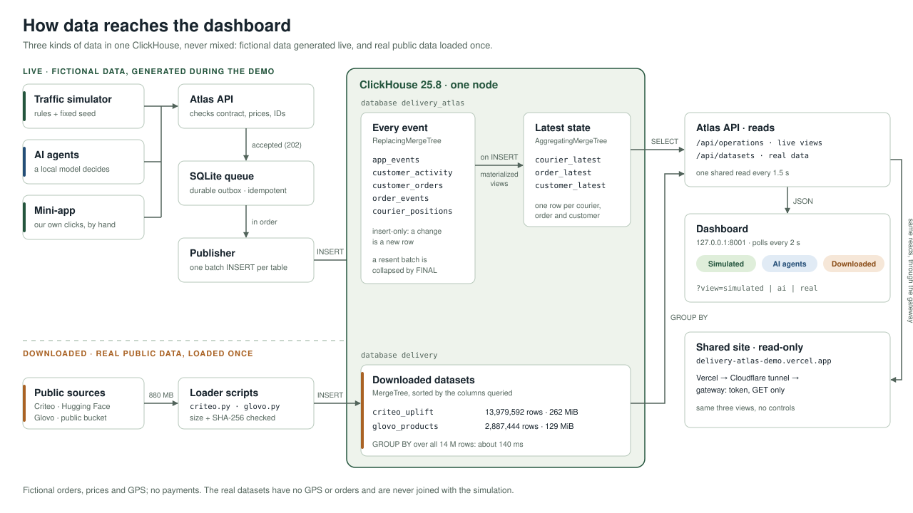

# Delivery Atlas v1 infrastructure

**Extension in this version:** the v1 browsing contract is kept, and orders/GPS are added in `sql/atlas_operations.sql`, together with a demo catalog and the tracking dashboard. The root of port 8001 now serves that dashboard. Current documentation of the new routes, fields and provenance: [DATA-AND-TRACKING.md](DATA-AND-TRACKING.md). The commercial mini-app is documented in [MINIAPP.md](MINIAPP.md).

Date: 7 October 2026. Implementation: `compose.yaml`, `Dockerfile.atlas`, `atlas/` and `sql/atlas.sql`. The earlier lab keeps its `delivery` database. The earlier `delivery_proposal` proposal is not the database applied by this version.

## 1. Short explanation for the team



Anuar builds a small fictional app. Each action creates an event with an ID. Python checks the event and records it in a persistent queue. A publisher collects batches and inserts them into ClickHouse. ClickHouse stores the details and prepares daily counts. Echenique's dashboard queries those counts through Python.

```text
Anuar's mini-app / Jere's generator
                  |
            POST /api/events
                  |
     Validation and stable ID (Python API)
                  |
       Persistent local queue (SQLite)
                  |
            Batch publisher
                  |
       ClickHouse: delivery_atlas.app_events
                  |
         Materialized view of IDs
                  |
         app_daily_rollup -> app_daily_counts
                  |
              GET /api/summary
                  |
          Echenique's dashboard
```

SQLite is a small transport and retry log, not the store the dashboard queries. ClickHouse does the analytical work. The API runs in a container separate from the ClickHouse node. Two containers do not mean two database nodes.

## 2. Reproducible start without large downloads

Requirements: Docker/Compose and Python 3.10 or later for the test and generation commands. The scripts use the standard library. The API uses Python 3.12 in Docker and ClickHouse 25.8. The `demo` values are credentials for the local lab.

**On Windows:** use `python` instead of `python3`. The recorded test and common problems are in [TEAM-INSTALL-TESTS.md](TEAM-INSTALL-TESTS.md).

```bash
docker compose -f compose.yaml --profile atlas up -d --build --wait
docker compose -f compose.yaml --profile atlas ps
python3 -m unittest discover -s tests -v
python3 scripts/check_atlas.py
python3 scripts/atlas.py generate --events 10000 --batch 1000 --seed 42
python3 scripts/atlas.py status
```

The API is at `http://127.0.0.1:8001`. ClickHouse receives HTTP at `127.0.0.1:8124`. Inside Compose, the API uses `http://clickhouse:8123/`. The old lab path uses `python3 dashboard.py` and port 8000: it is a different service.

Start-up applies the SQL idempotently before accepting events. It does not require OTTO, REES46, Ele.me or Glovo on a teammate's computer. The Python image is downloaded on the first build. Two volumes are mounted: the historical `clickhouse_data` and the new `atlas_queue`.

After editing Python, SQL or web files: repeat the start command with `--build`. To stop the API, `docker compose -f compose.yaml --profile atlas stop atlas`. The next start recovers the pending queue. Do not use `down -v`: it deletes the volumes.

## 3. SQL and physical model

| Object | One row represents | Role |
|---|---|---|
| `app_events` | One action or one physical copy of a retry | Detail, `ReplacingMergeTree(ingested_at)` |
| `app_daily_rollup` | A partial set of IDs per day/city/section/type/source | Aggregate state, `AggregatingMergeTree` |
| `app_daily_rollup_mv` | Rule that processes the inserted blocks | Produces `uniqExactState(event_id)` |
| `app_daily_counts` | Logical count per combination of dimensions | Read view with `uniqExactMerge` |

A row has a version, `event_id`, `session_id`, event time, receipt time, action, section, city, optional user/restaurant/product references and provenance. Unknown fields stay `null`.

Partitions group months within one node. The physical order starts with source, date, city and action, and ends with time, session and event ID. It guides lookups and groups identical retries together. **It does not enforce a unique key.**

`ReplacingMergeTree` removes copies during merges; to read logical events before those merges, use `FINAL`. The incremental view sees inserts, not the later removal of duplicates. That is why we do not increment `count()` in a `SummingMergeTree` as in the initial proposal: we store sets of IDs and count each ID once per group. This uses more memory than a simple counter and needs to be measured.

The API prevents changing the dimensions of an already accepted event. With the same ID and different content it returns 409. The guarantee depends on using this publisher and keeping its log. Manual inserts with the same ID and different dimensions are not covered.

```bash
docker exec -it bd2-clickhouse clickhouse-client --user demo --password demo
```

```sql
SELECT count() FROM delivery_atlas.app_events FINAL;
SELECT * FROM delivery_atlas.app_daily_counts ORDER BY event_date, city_id;
DESCRIBE TABLE delivery_atlas.app_events;
SHOW CREATE TABLE delivery_atlas.app_daily_rollup_mv;
```

The explained queries are also in `sql/atlas_consultas.sql`.

## 4. Contract and endpoints for Anuar and Echenique

Send an object `{"events": [...]}`. Maximum 5000 events or 5 MiB per request. Each batch is validated as a whole: one invalid entry rejects the whole batch.

```json
{
  "events": [{
    "schema_version": 1,
    "event_id": "fc7693c4-c366-4e55-a3c3-8aba2cd0c153",
    "session_id": "4ab0d7cb-aae4-41f6-b1dc-2bfc1d7e984",
    "event_time": "2026-10-07T10:00:00.000Z",
    "event_type": "restaurant_opened",
    "section": "restaurants",
    "city_id": "madrid",
    "restaurant_id": "fictional-madrid-1",
    "source": "delivery-miniapp",
    "source_kind": "demo_live"
  }]
}
```

This is a format sample, not an observed interaction. For a new action, create UUIDs with `crypto.randomUUID()` and the date with `new Date().toISOString()`. Store the object before sending it and reuse it when retrying. `demo_live` means a new action in a fictional app, not real use of Uber Eats.

| Route | Use / response |
|---|---|
| `POST /api/events` | 202: new events stored in the queue. 200: everything was a known retry |
| `GET /api/status` | Accepted, duplicates, pending, published by this API and errors |
| `GET /api/summary` | Logical counts from ClickHouse, not from SQLite |
| `GET /api/recent` | Last 30 logical events, including ID, session and both times |
| `GET /health` | Checks the connection to ClickHouse; shows the publisher's recent error |
| `GET /api/datasets` | Live summary of the downloaded public datasets (Criteo, Glovo) with ClickHouse's own elapsed time and rows read; `null` for a dataset that is not loaded |

**The three data views of the dashboard.** A selector at the top of http://127.0.0.1:8001/ switches between three kinds of data without mixing them. The choice is kept in the address (`?view=simulated`, `?view=ai`, `?view=real`), so a link opens the same view, including on the shared site.

| View | Data | Where it comes from |
|---|---|---|
| Simulated customers | Fictional customers of the traffic simulator or the test policy, plus orders placed by hand in the mini-app | The current run; counters from `operations.metrics_by_kind.simulated` and `customer_metrics_by_kind.simulated` |
| AI agents | Fictional customers whose decisions come from the local model (Ollama) | The same run; the `ai` entries. Start a run with "AI + mass traffic" (three AI agents plus simulated traffic) or "Local AI · Ollama". A customer counts as an AI agent from its first model decision |
| Downloaded datasets | Real public data: the Criteo Uplift advertising experiment (14.0 M rows) and the Glovo FooDI-ML catalog (2.9 M products) | `GET /api/datasets` and the inventory. No GPS or orders, never joined with the simulation |

The courier fleet is shared by every customer type, so the map shows all couriers in both live views. The downloaded datasets are optional; without them the third view says they are not loaded. To load them on the demo server (about 880 MB of downloads, verified by size and SHA-256):

```bash
python scripts/glovo.py download
python scripts/glovo.py prepare
python scripts/glovo.py load
python scripts/criteo.py download
python scripts/criteo.py load
```

`/api/summary` accepts `from=YYYY-MM-DD`, `to`, `city_id`, `source_kind` and `event_type`. Example: `/api/summary?city_id=madrid&source_kind=synthetic`. The list of groups is limited to 10000; `events` and `groups` are the total for the filter, and `truncated` says whether groups are missing from the list.

v1 actions: `search`, `filter_applied`, `restaurant_opened`, `product_opened`, `product_impression`, `cart_added` and `order_submitted`. Restaurant actions need `restaurant_id`; opening a product, impressions and cart actions also need `product_id`. A simulation requires `simulation_run_id`; a historical source requires `source_record_id`.

Errors: 400 format/contract, 409 ID with different content, 413 size, 503 queue full or database unavailable for reads. For 503 and network errors, retry the original object with a wait. Do not retry 400/409/413 indefinitely. A full queue does not accept the batch.

Serving the mini-app and dashboard files from the same port 8001 avoids the need for CORS. The final screens are the responsibility of Anuar and Echenique.

## 5. Acknowledgement, failures and limits

202 means **durably received**, not yet published to ClickHouse. The publisher collects up to 5000 events. It polls the queue every second when it is empty and pauses 0.3 seconds between batches. If a publish fails, it leaves the entries pending and tries again.

The SQLite log uses WAL, durable commits and transactions. Limit: 200000 pending events, configurable through `ATLAS_MAX_PENDING`. It keeps the published IDs, fingerprints and payloads: there is no automatic cleanup and its disk usage grows with the history. This makes it possible to recognize old retries, but it is a limitation of the classroom version.

If ClickHouse received the batch but the response was lost, the queue may send it again. There may be repeated physical rows. Reading with `FINAL` and the ID sets in the aggregate avoid inflating logical events for immutable content. It is neither a distributed transaction nor a universal exactly-once guarantee.

The lost-response test publishes an entry from a temporary queue and sends it again after reopening that queue. Those check events appear in `test-city`. The queue metrics belong only to the main publisher, not to SQL inserts or other test publishers.

A single API/publisher process and one ClickHouse node. Do not run two APIs sharing the same queue, and do not claim high availability. There is no Kafka, sharding, replicas, automated backup or separate read/write permissions. The database and the API only expose ports to the local host. A shared deployment requires authentication and permissions before opening them beyond localhost.

## 6. Generation and measurements

```bash
python3 scripts/atlas.py generate --events 1000000 --batch 5000 --seed 42 --start 2026-10-06T10:00:00Z
python3 scripts/atlas.py status
python3 scripts/benchmark_atlas.py
```

Wait for `pending=0` and do not send more events during the benchmark. The generator creates five-action sessions, three cities and fictional restaurants. Every path completes its five steps, an intentional simplification; they are not an estimate of real demand or conversion.

It saves the seed, start date, run ID, parameters, payload fingerprint and send time in `data/atlas/<run-id>.json`. Repeating the same configuration with the same ID and date produces the same logical load. Changing the batch size does not change the IDs. `--rate` sets a send target, not a guaranteed speed. The send speed includes creating events and queue confirmation; on its own it does not measure publishing or dashboard delay.

`benchmark_atlas.py` compares three queries on the detail with `FINAL` and three on the aggregate, with the SQL cache disabled. It checks that the results are equal and saves wall-clock time, server time, and rows and bytes read. OTTO's 27.9× is not imported as a result for this database.

`scripts/check_atlas.py` records its evidence in `data/atlas/checks.json`. Run it without concurrent load to compare detail and aggregate. The unit tests check concurrent retries, log recovery, a conflict with batch rollback, a full queue and an invalid contract.

## 7. What is left to close the project

Anuar's complete mini-app; Echenique's dedicated dashboard; an independent test on another computer; fitting the existing CRUD into the demo; a load with more realistic abandonment/schedules; measuring delay up to the dashboard and latencies under concurrent load; documented backup and restore; a rehearsal of the 30 minutes.

**Verified on 7 October:** one million synthetic events accepted and verified in ClickHouse, retries, ID conflict, equality between detail and aggregate, and recovery of a pending entry after orderly shutdowns. The new aggregate was not faster in the local benchmark (0.703 s vs 0.498 s); studying its cost is a pending task. See [results and conditions](ATLAS-RESULTS.md) and [exported evidence](evidencia-atlas.json).

`python3 scripts/recover_atlas.py` reproduces the recovery test and briefly stops local services; run it with no other jobs active. `python3 scripts/crud_demo.py` demonstrates operations on `delivery.demo_events`, a separate scratch table. Atlas events are immutable and their incremental views do not automatically recompute a modified history.

The local log and the exact aggregates have costs that will need measuring at larger scale. Replication or sharding are later experiments. Compatibility with future sources requires adapting and validating their fields: the contract does not turn any dataset into clicks automatically.

## Technical references

- [ReplacingMergeTree](https://clickhouse.com/docs/reference/engines/table-engines/mergetree-family/replacingmergetree).
- [AggregatingMergeTree](https://clickhouse.com/docs/reference/engines/table-engines/mergetree-family/aggregatingmergetree).
- [Retries and deduplication limits](https://clickhouse.com/docs/concepts/features/operations/insert/deduplicating-inserts-on-retries). The current documentation includes changes after 25.8; this version does not depend on those newer settings.
- Repository code and tests; [applied theory and pending tasks](THEORY-REVIEW.md).
