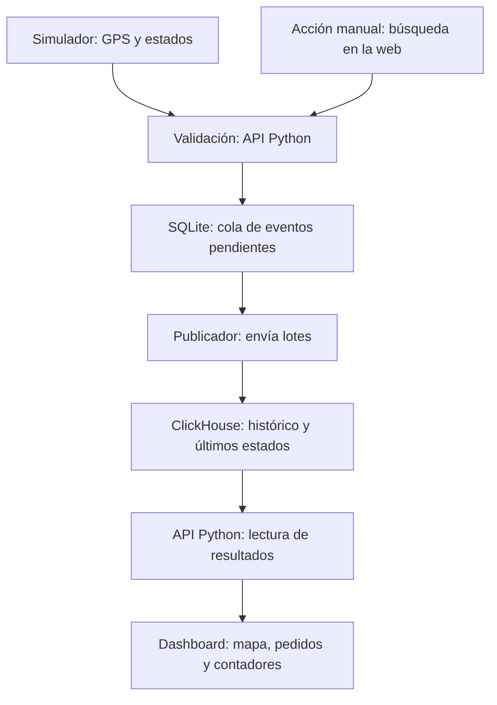
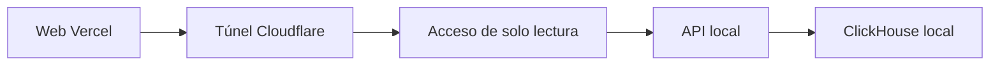

# Delivery Atlas: guía visual para entenderlo rápido

Para Jere, Anuar y Echenique. Revisión: 14/10/2026. Resumen del documento técnico; los recuentos y la publicación citados se comprobaron el 7/10. No verifica que el laboratorio esté encendido hoy.

## 1. Qué estamos haciendo

Construimos una plataforma ficticia de comida a domicilio: guardamos eventos en ClickHouse y mostramos un dashboard con repartidores que se mueven, pedidos y contadores.

**Fuentes públicas:** OTTO y REES46 aportan cientos de millones de eventos históricos. Ele.me aporta muestras de recomendaciones; Glovo, productos de catálogo. Sirven para estudiar volumen y consultas. No comparten usuarios ni IDs entre sí.

**Nuestro escenario:** Madrid, 12 repartidores simulados por defecto, pedidos e importes ficticios y acciones de navegación generadas o manuales. Sirve para demostrar nuestra infraestructura en funcionamiento.

ClickHouse no captura clics solo: nuestro código crea o recibe registros y la base permite consultarlos. El tracking se simula, pero el mapa lee posiciones que han pasado por la cola y ClickHouse.

**Ya tenemos:** base, ingesta, simulación, dashboard y web compartida.
**Falta:** miniapp comercial con checkout conectado a un pedido y reproducción comprobada en otro ordenador.

## 2. Cómo se conecta todo



Las flechas muestran el recorrido de los datos. El dashboard pide resultados a la API, que consulta ClickHouse. Validación y lectura pertenecen al mismo programa; el simulador integrado utiliza directamente su validación y cola.

- **API:** la puerta de entrada y de consulta.
- **SQLite:** sala de espera persistente.
- **Publicador:** envía varios registros juntos.
- **ClickHouse:** almacena y calcula lo que consultamos.
- **Dashboard:** representa esos resultados.

Docker arranca y conecta los servicios. Hay un solo nodo ClickHouse; tener API y cola no añade nodos de esa base de datos.

## 3. Qué guardamos y qué vemos

| Tabla | Una fila representa | En el panel |
|---|---|---|
| `app_events` | Una acción: buscar, abrir o añadir al carrito | Recuentos de navegación |
| `order_events` | La foto de un pedido en un estado | Activos, entregados, cancelados e importe ficticio |
| `courier_positions` | Una posición del repartidor, con ID y hora | Marcador y recorrido del pedido |

**Ejemplo de una posición nueva:** el simulador mueve un repartidor, la validación acepta el registro en la cola, el publicador lo inserta y una consulta posterior actualiza el mapa.

Aceptar en cola no significa que ya se vea. Si el mismo evento se reenvía con el mismo ID y contenido, las consultas lógicas evitan contarlo como otro. Una posición antigua que llegue tarde no sustituye a una posición de hora más reciente.

Hay dos bases lógicas en el mismo servidor: `delivery` para históricos y `delivery_atlas` para nuestra plataforma. Los clics simulados y los pedidos son escenarios independientes: no calculamos una conversión comercial entre ellos.

Generación solicitada cada 2 s; el panel consulta después de terminar su lectura y esperar 2 s. La demora puede ser mayor. El mapa representa coordenadas ficticias, no calles ni GPS de repartidores reales.

## 4. Cómo empezar juntos

**Ver:** abrir https://delivery-atlas-demo.vercel.app (solo lectura). Depende de que el ordenador de Jere, Docker y el túnel estén activos.

**Ejecutar localmente:** obtener el código de la rama `codex/actualizacion-clickstream-eleme` mientras la PR no esté integrada. Con Docker/Compose, desde la carpeta del proyecto:

```bash
docker compose -f compose.yaml --profile atlas up -d --build --wait
```

Abrir http://127.0.0.1:8001/, iniciar la simulación, elegir un repartidor y observar cómo cambian hora y coordenadas. La demo pequeña no necesita descargar los históricos masivos.

**Anuar: por dónde empezar.** Entender qué campos tiene una acción y cómo se envía. Leer `atlas/contract.py` y el botón manual del dashboard. Siguiente aportación posible: miniapp comercial.

**Echenique: por dónde empezar.** Seguir qué consulta alimenta cada métrica y comprobar el panel en su ordenador. Leer `atlas/clickhouse.py` y `web/atlas-dashboard.js`.

**Jere + Rayo:** apoyar dudas de base, ingesta y simulación. Estas son rutas de incorporación; el reparto definitivo se acordará juntos.

### Cómo llega una consulta compartida



ClickHouse y el simulador siguen en el ordenador de Jere. Los controles de iniciar/parar están en la demo local.

**Guía completa:** `docs/DOCUMENTO-TECNICO-EQUIPO.md` y su PDF de 17 páginas. Instalación detallada: `docs/DEMO-TRACKING.md`. Compartición: `docs/COMPARTIR-VERCEL.md`.
