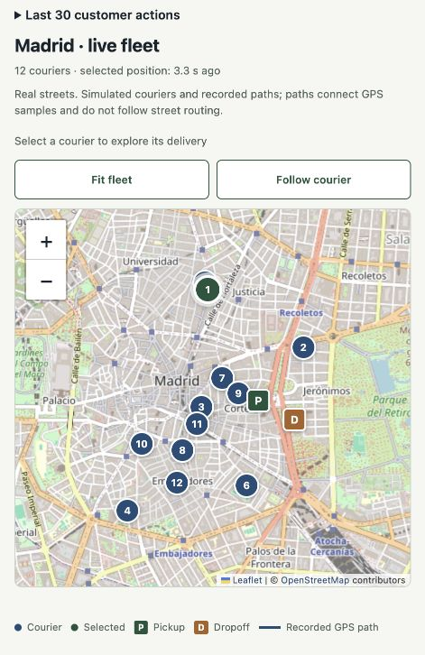

# Interactive Madrid map

The operations dashboard uses self-hosted Leaflet 1.9.4 and OpenStreetMap street tiles. The initial view fits the fleet once; subsequent refreshes preserve the viewport. **Fit fleet** restores the overview and **Follow courier** explicitly opts into centering the selected courier. The dropdown also makes overlapping markers selectable.

Couriers, pickup/dropoff locations and GPS histories remain fictional. The blue path connects recorded samples from ClickHouse; there is no street-routing or map-matching service. Invalid coordinates are omitted rather than replaced with a made-up location. The history is cleared only when the run, courier or order changes, and obsolete responses cannot replace the current selection's path.

The map initializes when it approaches the viewport, reuses marker instances, disables scroll-wheel zoom to preserve page scrolling, and supports zoom buttons, keyboard navigation and touch. Polling pauses in a hidden document. Leaflet's ResizeObserver handles responsive layout changes; map observers and layers are removed when the page is discarded.

Street tiles require network access. They use the standard HTTPS tile URL, visible attribution and normal browser caching, with no bulk download or prefetch. If tiles fail, courier details and position layers remain available. This follows the [OpenStreetMap tile usage policy](https://operations.osmfoundation.org/policies/tiles/). Leaflet's BSD license is included under `web/vendor/leaflet/LICENSE`.

## Verification, 21 October 2026

- `node --test tests/*.cjs`: 10 tests passed, including geographic validation and the existing checkout/tracking tests.
- JavaScript syntax checks, shared-site build and `git diff --check` passed.
- Browser checked against the live read-only backend: 12 courier markers, one selection, dropdown, follow toggle, fit-fleet and zoom controls. No warning/error console logs observed.
- Mobile viewport 390×844: document width 390 px, map width 358 px; no page overflow. Desktop uses two columns; mobile stacks map and details.
- The UI detector's two advisory findings were inspected: em-dashes are existing empty-value placeholders; the 3 px border is the GPS-line legend, not a card accent. Neither affects the map interaction.

These checks do not establish a maximum fleet rendering capacity or guarantee the external tile service's availability.

## Published result

The verified version is live at [Delivery Atlas](https://delivery-atlas-demo.vercel.app/#tracking). [Deployment evidence](evidencia-mapa.json) records the source revision, route checks and measurements. The code is in [PR #8](https://github.com/Gere2/analitica-reparto-clickhouse/pull/8).

[Desktop evidence](capturas/mapa-madrid-escritorio.jpg) and [mobile evidence](capturas/mapa-madrid-movil.jpg) can also support the presentation if the live connection is unavailable.
